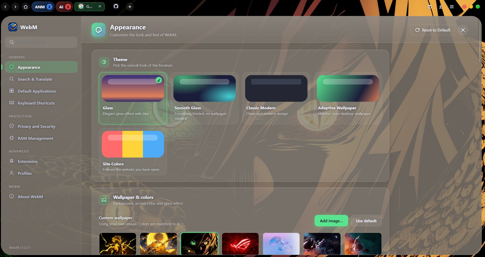
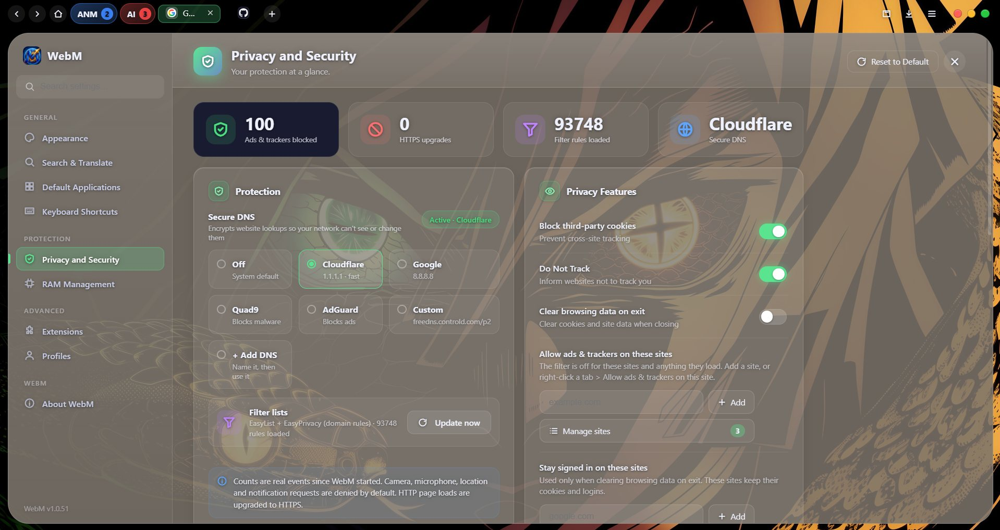
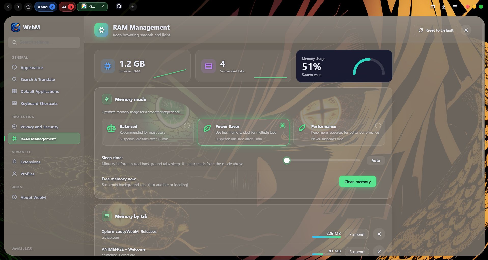
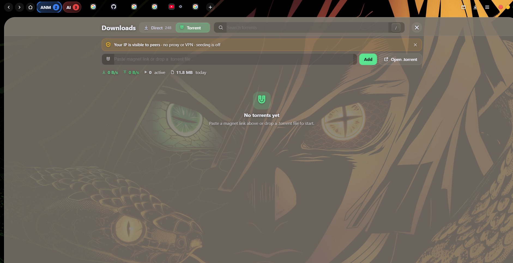

 

# WebM Browser

### Your browser for browsing, productivity, privacy, and media.

A modern Chromium-based browser for Windows, bringing everyday browsing tools and useful extras together in one compact experience.

[**Download the latest release**](https://github.com/Xplore-code/WebM-Releases/releases/latest) · [Report an issue](https://github.com/Xplore-code/WebM/issues)

---

## A look inside WebM

  

WebM pairs a compact browser layout with a customizable interface. Choose a visual style, personalize the wallpaper, and make the browser feel like your own.

## What's new in 1.0.52

- **Faster, lighter start-up.** When you reopen WebM, only the tab you were last on loads. Your other tabs and tab groups come back asleep, with their real titles and icons, and wake only when you open them. Up to 100 tabs are remembered (it was 30).
- **Router and local-network pages now open.** Addresses like `192.168.1.1`, `192.168.0.1`, `10.0.0.1`, `router:8080` and `localhost` open over `http://` when you type them without a scheme. Routers with a self-signed certificate show a **Continue (unsafe)** choice that applies to private addresses only and lasts for the session. Known router names such as `smartbrosettings.net` open correctly even with Secure DNS on.
- **New Rust-powered ad and tracker blocker.** WebM now uses Brave's `adblock-rust` engine to apply full EasyList and EasyPrivacy rules (paths, resource types, third-party and exceptions), not just domain names. If the engine can't load, WebM falls back to its built-in blocker.
- **Optional Stronger ad blocking.** In **Settings → Privacy** you can switch on extra uBlock Origin and Peter Lowe lists for more blocking. It is off by default and can be turned off again at any time if a site misbehaves.

See the [1.0.52 release notes](https://github.com/Xplore-code/WebM-Releases/releases/tag/v1.0.52) for the full list.

---

## Features

<table>
  <tr>
    <td width="50%" valign="top">
      <h3>🎨 Custom appearance</h3>
      Choose from Glass, Smooth Glass, Classic Modern, Adaptive Wallpaper, and Site Colors themes. Personalize the browser with your own wallpaper and accent colors.
    </td>
    <td width="50%" valign="top">
      <h3>🛡️ Privacy and security</h3>
      Rust-powered ad and tracker blocking, an optional Stronger ad blocking mode, Secure DNS options, cookie controls, and site-specific permissions in one place.
    </td>
  </tr>
  <tr>
    <td width="50%" valign="top">
      <h3>🧠 RAM management</h3>
      Choose a memory mode, let idle tabs sleep, and restore your last session without loading every tab at once.
    </td>
    <td width="50%" valign="top">
      <h3>🪟 Split-view browsing</h3>
      Work with multiple web pages side by side in one browser window.
    </td>
  </tr>
  <tr>
    <td width="50%" valign="top">
      <h3>🪟 Floating browser window</h3>
      Open an entire website in a separate movable floating window while continuing to use your main browser.
    </td>
    <td width="50%" valign="top">
      <h3>🎬 Picture-in-Picture</h3>
      Keep supported videos playing in a small floating player while browsing other pages.
    </td>
  </tr>
  <tr>
    <td width="50%" valign="top">
      <h3>⬇️ Integrated downloads</h3>
      Manage downloads from WebM's built-in downloads interface.
    </td>
    <td width="50%" valign="top">
      <h3>🎵 Music player</h3>
      Play supported music and audio files with WebM's built-in media player.
    </td>
  </tr>
  <tr>
    <td width="50%" valign="top">
      <h3>🎥 Video player</h3>
      Play supported video files directly through WebM's media playback features.
    </td>
    <td width="50%" valign="top">
      <h3>🧩 Browser extensions</h3>
      Extension management is part of the WebM experience. Some extension functionality may still be under testing.
    </td>
  </tr>
  <tr>
    <td width="50%" valign="top">
      <h3>📡 Router and local devices</h3>
      Open router dashboards and other devices on your network, including pages that use plain HTTP or a self-signed certificate.
    </td>
    <td width="50%" valign="top">
      <h3>🔄 Automatic updates</h3>
      The installed version checks for updates in the background and offers <strong>Restart &amp; Update</strong> when one is ready.
    </td>
  </tr>
  <tr>
    <td width="50%" valign="top">
      <h3>🌐 Chromium-based browsing</h3>
      Enjoy everyday web browsing with WebM's Chromium-based engine.
    </td>
    <td width="50%" valign="top">
      <h3>📥 Portable support</h3>
      Choose the portable version to run WebM without a traditional installation.
    </td>
  </tr>
</table>

## Screenshots

  
<strong>Privacy and security</strong>

   
  

  
<strong>RAM management</strong>

   
  

  
<strong>Split-view browsing</strong>

   
  

  
<strong>Downloads</strong>

   
  

## Download WebM

Get the latest available release from the **WebM Releases** page:

Choose the Windows package that suits you:

| Package | Description |
|---|---|
| **Windows Installer** (`WebM-<version>-x64-Setup.exe`) | Install WebM for regular use. Updates itself automatically. |
| **Windows Portable** (`WebM-<version>-x64-Portable.exe`) | Run WebM without installing. Does not update itself: download the new file for each release. |

Open the latest release and download the corresponding `.exe` asset.

## Installation

1. Open the [latest WebM release](https://github.com/Xplore-code/WebM-Releases/releases/latest).
2. Download either the Windows Installer or Windows Portable package.
3. If you downloaded the installer, open it and follow the setup instructions.
4. If you downloaded the portable package, run the executable from your chosen folder.

## Release history

| Version | Highlights |
|---|---|
| **1.0.52** | Faster session restore (only the last tab loads), router and local-network support, Rust ad blocker, optional Stronger ad blocking. |
| 1.0.51 | Previous release. |

Every release lists its changes on the [Releases page](https://github.com/Xplore-code/WebM-Releases/releases).

## Good to know

- **Windows warning on first run:** WebM is an independent project and the installer may not be code-signed, so Windows SmartScreen can show a warning. Choose **More info → Run anyway** if you downloaded it from this page.
- **Router certificate warnings:** when a router uses a self-signed certificate, WebM blocks the page by default and lets you continue for that private address only. Don't use this on public Wi-Fi.
- **Stronger ad blocking** can occasionally break a site. If that happens, turn it off in Settings → Privacy.

## Project information

- **Platform:** Windows
- **Browser engine:** Chromium
- **Project:** WebM Browser
- **Developer:** KRAM

WebM is an independently developed browser project. Features and compatibility may evolve between releases.

## Support and feedback

Found a bug or have an idea to improve WebM? Open an issue in the [WebM source repository](https://github.com/Xplore-code/WebM).

---

**WebM Browser**  
Made for everyday browsing.

