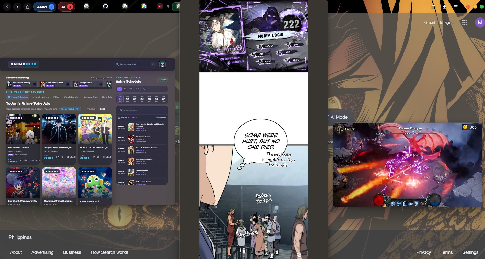

 

# WebM Browser

### Your browser for browsing, productivity, privacy, and media.

A modern Chromium-based browser for Windows, bringing everyday browsing tools and useful extras together in one compact experience.

[**Download the latest release**](https://github.com/Xplore-code/WebM-Releases/releases/latest) · [Report an issue](https://github.com/Xplore-code/WebM/issues)

---

## A look inside WebM

  

WebM pairs a compact browser layout with a customizable interface. Choose a visual style, personalize the wallpaper, and make the browser feel like your own.

## Features

<table>
  <tr>
    <td width="50%" valign="top">
      <h3>🎨 Custom appearance</h3>
      Choose from Glass, Smooth Glass, Classic Modern, Adaptive Wallpaper, and Site Colors themes. Personalize the browser with your own wallpaper and accent colors.
    </td>
    <td width="50%" valign="top">
      <h3>🛡️ Privacy and security</h3>
      Access privacy controls, Secure DNS options, filter lists, cookie controls, and site-specific permissions from one place.
    </td>
  </tr>
  <tr>
    <td width="50%" valign="top">
      <h3>🧠 RAM management</h3>
      Choose a memory mode, manage sleeping tabs, and review memory usage to help keep browsing sessions organized.
    </td>
    <td width="50%" valign="top">
      <h3>🪟 Split-view browsing</h3>
      Work with multiple web pages side by side in one browser window.
    </td>
  </tr>
  <tr>
    <td width="50%" valign="top">
      <h3>⬇️ Integrated downloads</h3>
      Manage downloads from WebM's built-in downloads interface.
    </td>
    <td width="50%" valign="top">
      <h3>🎵 Music player</h3>
      Play supported music and audio files with WebM's built-in media player.
    </td>
  </tr>
  <tr>
    <td width="50%" valign="top">
      <h3>🎬 Video player</h3>
      Play supported video files directly through WebM's media playback features.
    </td>
    <td width="50%" valign="top">
      <h3>🖼️ Picture-in-Picture</h3>
      Keep supported videos in a floating window while browsing other pages.
    </td>
  </tr>
  <tr>
    <td width="50%" valign="top">
      <h3>🧩 Browser extensions</h3>
      Extension management is part of the WebM experience. Some extension functionality may still be under testing.
    </td>
    <td width="50%" valign="top">
      <h3>🌐 Chromium-based browsing</h3>
      Enjoy everyday web browsing with WebM's Chromium-based engine.
    </td>
  </tr>
</table>

## Screenshots

  
<strong>Privacy and security</strong>

   
  

  
<strong>RAM management</strong>

   
  

  
<strong>Split-view browsing</strong>

   
  

  
<strong>Downloads</strong>

   
  

## Download WebM

Get the latest available release from the **WebM Releases** page:

Choose the Windows package that suits you:

| Package | Description |
|---|---|
| **Windows Installer** | Install WebM on your Windows PC for regular use. |
| **Windows Portable** | Run WebM without a traditional installation. |

Open the latest release and download the corresponding `.exe` asset.

## Installation

1. Open the [latest WebM release](https://github.com/Xplore-code/WebM-Releases/releases/latest).
2. Download either the Windows Installer or Windows Portable package.
3. If you downloaded the installer, open it and follow the setup instructions.
4. If you downloaded the portable package, run the executable from your chosen folder.

## Project information

- **Platform:** Windows
- **Browser engine:** Chromium
- **Project:** WebM Browser
- **Developer:** KRAM

WebM is an independently developed browser project. Features and compatibility may evolve between releases.

## Support and feedback

Found a bug or have an idea to improve WebM? Open an issue in the [WebM source repository](https://github.com/Xplore-code/WebM).

---

**WebM Browser**  
Made for everyday browsing.

